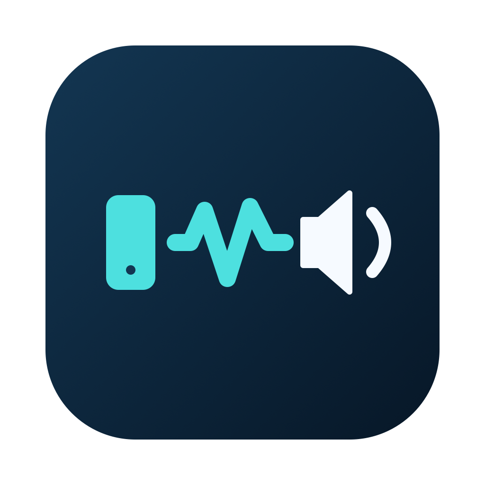

# ThunderAudio 雷雳音频桥



当前版本：**0.4.1** · Apple Silicon · macOS 13+

[下载最新版](https://github.com/wwwwzzzzkkkk/ThunderAudio/releases/latest) · [版本记录](CHANGELOG.md)

macOS 原生菜单栏应用。同一个应用放到两台 Mac：Mac mini 采集系统声音，MacBook 通过内置扬声器播放。支持 Apple Silicon、macOS 13 及以上；无第三方依赖、无需虚拟声卡或内核扩展。

**这是用户空间的网络音频应用。雷电线提供 Thunderbolt Bridge IP 网络，另一台 Mac 的扬声器不会成为 macOS「声音输出」列表里的雷电硬件。**


## Homebrew 安装和更新

同一个 GitHub 仓库同时提供 Cask；首次在每台 Mac 执行：

```sh
brew tap wwwwzzzzkkkk/thunderaudio https://github.com/wwwwzzzzkkkk/ThunderAudio.git
brew install --cask wwwwzzzzkkkk/thunderaudio/thunderaudio
```

以后先退出两端 ThunderAudio，再分别更新：

```sh
brew update
brew upgrade --cask wwwwzzzzkkkk/thunderaudio/thunderaudio
```

Homebrew 会从 GitHub Release 下载带版本号的安装包并校验 SHA-256。没有内置静默更新器，`brew update` 只刷新清单，`brew upgrade` 才会替换应用。若 `/Applications` 已有手动安装的同名应用，先退出并移走旧副本，再交给 Homebrew 安装；不用删除用户数据或录制权限。

本版本为临时签名的开发构建，尚未 Developer ID 签名和公证。Homebrew 安装不代表通过 Apple 公证；首次打开或重建后，仍可能需要系统允许打开和重新授予录制权限。不要关闭 Gatekeeper 或 SIP。两台 Mac 应使用兼容的同一版本。

## v0.2：播放位置切换与合盖提示

**v0.2 起使用 TA2 协议，v0.1 不兼容。** 首次升级时建议两端使用同一新版。若发送端提示采集权限错误，请按 macOS 提示重新授予录制权限。

在 **Mac mini 的发送端菜单** 中选择「声音播放位置」：

- **Mac mini**：不再发送音频，MacBook 清空队列并暂停播放。本机恢复切换前的静音状态，沿用当前系统输出设备与音量；若原本已静音或音量为零，请在系统声音设置调整。
- **MacBook**：等待接收端确认和系统音频采集就绪后，将 Mac mini 当前默认输出设备静音，再发送音频。这里改变的是本机设备静音状态，不改变音量，也不创建虚拟声卡。
- 如果当前默认输出不支持自动静音，应用会退回 Mac mini 模式并显示原因，避免两边同时响。正常断线、停止、退出时恢复原静音状态；强制结束、崩溃或断电可能无法恢复，需要手动取消静音。不要同时启动多个版本管理同一输出设备。
- 播放位置切换期间保持连接和采集会话，以便快速恢复远端；Mac mini 模式不会发送音频数据。切到 MacBook 后仍需在目标设备上确认声音正常，尚未双机验证系统静音与采集之间的实际行为。
- 如果切换后在系统中更改默认输出设备，应用会在后续状态刷新时恢复旧设备、尝试静音新设备；短暂切换期间可能存在本机声音。

MacBook 接收端会显示系统供电和外接显示器检测信息。**电源线 + 两台 Mac 之间的雷电线，仍不等于官方合盖模式。** 需要实际外接显示器、电源以及键盘、鼠标；显示器检测可能包括虚拟显示器，提示不构成满足全部合盖条件的证明。当前没有外接显示器时，请开盖使用并让屏幕正常熄灭，可按需开启阻止空闲睡眠。

系统睡眠前暂停音频并恢复发送端静音状态；唤醒后接收端重新监听、发送端尝试重连。没有添加绕过合盖睡眠保护的功能。

屏幕共享与音频桥同时启用时，可能出现重复播放 / 无声；需要远程操作时先关闭屏幕共享音频（若系统提供），或断开屏幕共享后听音。

## 已实现

- SwiftUI 菜单栏界面；发送 / 接收角色；Bonjour 接收端发现和手动 IP。
- ScreenCaptureKit 采集 48 kHz、双声道 Float32 音频；不传输或存储屏幕帧，不采集麦克风。排除应用自身音频。
- Network.framework TCP + TLS 1.2 PSK（AES-128-GCM）。两端需输入相同口令；v0.4 默认使用一次输入的 6 位码，也接受长随机口令；按设备存入钥匙串。Bonjour 仅公布服务名称，不公布口令。
- 启动时若系统明确报告一个可用雷雳接口，会优先选中它；使用系统网络服务名称和 IPv4 地址辅助识别接口；选定接口后用 `requiredInterface` 约束连接，不静默回退到 Wi-Fi。自动模式遵从系统路由，不保证走雷电。
- CoreAudio 选择具有输出流的内置音频设备，AVAudioEngine / AVAudioPlayerNode 播放。失败时显示错误，不静默改用外接扬声器。
- 接收音量、断线检测、3 秒重连、两秒心跳、网络往返时间、本机播放队列、丢弃块统计。
- 可选系统空闲睡眠断言，停止时释放；不会阻止合盖睡眠、强制睡眠或关闭系统保护。

## 首次配对与日常连接（v0.4）

1. 两台 Mac 安装新版并打开。MacBook 选择接收端，界面自动生成 **6 位数字配对码**；点击「开始接收」。
2. Mac mini 选择发送端。局域网搜索列表会显示运行中的接收端电脑名称；选中 MacBook，首次输入它的配对码，点击「连接」。
3. 默认勾选「记住配对码」：接收端启动时、发送端验证成功后，口令写入 **macOS 登录钥匙串**，不写入偏好设置、日志、Bonjour 或代码仓库。发送端按设备分别保存，切换已配对设备时读取对应口令。
4. 默认勾选「打开应用后自动连接 / 接收」：之后打开应用会恢复角色、上次设备 / 手动 IP、网络接口和已保存的配对码。若指定网桥尚未出现，会等待该接口，不转到无线网络。应用未运行时无法接收；此选项不等于登录时自动启动应用。
5. 首次允许本地网络、防火墙和发送端系统录制权限。钥匙串锁定、权限被拒绝或升级后身份变化时，macOS 可能要求允许访问；读取失败会明确提示并允许手动输入，不会改成明文保存。
6. 「网络与配对选项」内可手动填写 IP、指定网桥、忘记当前设备的配对。忘记配对会删除本机当前设备的钥匙串记录并关闭记住选项，不会远程删除另一台的记录；当前已连接会话继续运行，停止后再输入新码。

接收端会直接显示配对码，数字前导零有效。支持 **恰好 6 位 ASCII 数字**，也保留 **16–128 字节长口令**，旧长口令可继续使用。更换接收端配对码时，先停止两端，再在发送端填入新码并重新连接。

6 位码减少输入量，但只有一百万种组合。现有 TLS-PSK 不具备 PAKE 的抗离线猜测能力；仅在可信家庭 / 办公局域网使用短码，安全要求较高时使用长随机口令。应用对重复失败的新连接做有限的暂停处理，这不能消除短码的猜测风险。不要转发端口到互联网。

搜索通过 Bonjour 查找 **已经启动接收的 ThunderAudio**，不是扫描所有 Mac 或获取其他设备的声音。点击「重新搜索」可重建浏览器。服务使用稳定的名字和域识别，不再按列表序号记忆，刷新 / 排序不会切错设备。相同服务在不同接口的发现结果合并，实际路由仍受选定接口约束。Bonjour 被防火墙、VPN 或网络隔离阻挡时，仍可展开网络选项填写网桥 IP。

权限名称随系统版本不同可能显示为「屏幕录制」或「屏幕与系统音频录制」。本应用只注册 `.audio` 输出，不传输图像、不写音频文件、不使用麦克风权限。初次测试保持开盖，不使用屏幕共享音频。

## 优先使用雷电线

1. 使用支持 **Thunderbolt 数据传输** 的线连接两台 Mac；只有 USB-C 外形并不保证支持雷电。先解锁 MacBook，按系统提示允许配件连接。
2. 两端打开「系统设置 → 网络 → 雷雳网桥 / Thunderbolt Bridge」，确认连接可用。不要把 Mac mini 当作 MacBook 的外接显示器。
3. 查看各端的网桥 IPv4 地址和接口名称。应用的接口列表会显示网络服务名、BSD 接口名和 IPv4。`bridge0` 常见但不固定；不要凭接口名就认定一定是雷电。
4. 两端应用都选择相应网桥接口，发送端填写接收端网桥 IPv4。接口被指定后，拔线应断开并重试，不能自动转到无线网络。
5. 如果系统没有配置可用 IPv4，可以在两端网桥的 TCP/IP 中手动设一个不与现有 LAN、VPN 重叠的私有子网。例如 Mac mini `192.168.77.1`、MacBook `192.168.77.2`，子网掩码 `255.255.255.0`，路由器和 DNS 留空。若原网络已占用此子网，换一个；只调整网桥服务。
6. Bonjour 跨接口发现可能失败；此时直接填 IP。Bonjour 发现在哪个接口看到设备，不等于最终音频连接一定走该接口。

界面显示限定接口及连接实际本地 / 远端 IP。自动模式列出的「可用接口」是候选信息，**不是对单个实际出口的证明**。可以在发送端终端运行以下只读检查，用接收端真实地址替换示例：

```sh
route -n get 192.168.77.2
networksetup -listnetworkserviceorder
```

确认路由中的 `interface` 对应系统「雷雳网桥」服务。若网桥没有出现在应用接口列表，先配置 IP 并重开应用；仍不可选时可用手动网桥 IP + 自动模式，但必须自行核对路由，不能声称已经限定雷电。

## 构建

### 完整 Xcode

下载 [Xcode](https://apps.apple.com/app/xcode/id497799835)，首次打开并安装组件。也可从 [Apple Developer](https://developer.apple.com/download/all/?q=Xcode) 下载。建议 Xcode 16 或更新版本。

1. 打开 `ThunderAudio.xcodeproj`。
2. 选择 ThunderAudio target 和 My Mac。
3. 默认开发签名使用本机临时签名。若需要长期安装 / 分发，在 Signing & Capabilities 选择自己的 Team，使用唯一 Bundle Identifier，再按正常 Developer ID 签名和公证流程发布。
4. Build / Run。Release 可从 Products 中取得 .app。

完整 Xcode 装好后，如命令仍只识别 Command Line Tools，可在终端选择 Xcode：

```sh
sudo xcode-select --switch /Applications/Xcode.app/Contents/Developer
xcodebuild -project ThunderAudio.xcodeproj -target ThunderAudio -configuration Release build
```

### 仅 Command Line Tools

当前构建脚本面向两台目标 Apple Silicon Mac。进入本文件所在目录运行：

```sh
./build.sh
open build/ThunderAudio.app
```

脚本使用 Swift 5 语言模式和 macOS 13 deployment target；在临时目录中构建和签名，输出 `build/ThunderAudio.app` 和可分发的 `build/ThunderAudio-0.4.1-macOS-arm64.zip`。只清理临时构建产物的扩展属性，不修改系统设置。推荐通过 ZIP 复制应用，避免云同步文件夹在签名过程中附加 Finder 元数据。二进制是 arm64，不支持 Intel Mac。重建同一 Bundle ID 的临时签名应用后，系统可能要求重新授予录制权限；正式稳定签名可减少身份变化。

## 合盖、休眠与唤醒

**仅插两台 Mac 之间的雷电线，不能保证 MacBook 合盖运行。**

- 最可靠的初始测试方法：接电、保持开盖，可以降低屏幕亮度或正常让屏幕熄灭。运行时按需开启「阻止空闲睡眠」。该选项使用 Apple 的 `PreventUserIdleSystemSleep` 断言，不强制屏幕常亮。
- 合盖使用遵循 macOS 支持的外接显示器模式：实际外接显示器、电源、外接键盘和鼠标 / 触控板；允许相关配件连接。请按具体 Mac / macOS 的官方说明配置，再实测声音。两台 Mac 之间的普通雷电连接不满足外接显示器条件。
- 不使用 `pmset disablesleep`、驱动、SIP 修改或其他绕过合盖保护的办法。应用不保证系统强制睡眠、低电量、热管理或更新期间仍能工作。
- 休眠期间音频中断且不会缓存在磁盘。唤醒后发送端保持运行会尝试重连。若采集权限 / 显示器状态变化令 ScreenCaptureKit 报错，需要在发送端重新启动发送；接收端音频设备重配置后若报错，需要停止再启动。
- 使用时保持通风；合盖本身也可能改变扬声器音色和听感。应用不能弥补物理遮挡。

## 实际限制

1. **采集范围**：当前原型采用第一块可采集显示器的 ScreenCaptureKit 过滤器，采集该过滤器允许的音频；不是虚拟声卡，不保证无显示器 / 锁屏 / 所有后台程序 / DRM 内容均可采集。采集本身不改变本机输出路由；v0.2 在 MacBook 模式就绪后会静音 Mac mini 当前默认输出设备，回到本机或停止时恢复原静音状态。
2. **传输**：原始 PCM 约 3.072 Mbit/s（未计 TLS/TCP 开销）。不做远程控制、文件服务或屏幕共享，端口固定 TCP 49731，只支持一个发送端。
3. **时延**：网络 RTT 不等于单程延迟或声卡到声卡延迟。界面队列为本机尚未完成播放的帧数估计；发送端不能看到接收端队列。没有跨机器时钟同步，不提供端到端实测数字或影音同步保证。
4. **缓冲**：播放队列上限 200 ms，发送网络积压约 200 KB 时丢弃新块。TCP 仍有队头阻塞；没有自适应抖动缓冲、丢包隐藏或精确采样时钟漂移补偿。长时间播放 / 不稳定网络可能出现掉音，需要进一步双机调优，暂不适合专业监听或实时乐器。
5. **安全**：TLS 使用共享口令派生 PSK，不忽略证书验证、不回退明文。建议生成随机口令；弱口令仍有猜测风险。使用固定 PSK 的 TLS 1.2 不提供前向保密。勾选记住时，口令保存在 macOS 登录钥匙串；偏好设置只保存设备与界面选项。配对码不自动复制到剪贴板。服务名称可被本地网络发现。不要将端口映射到互联网。
6. **恢复**：发送端 3 秒重试，心跳无响应超过 12 秒断开；连接 / 验证超时 8 秒。手动 IP 固定后 IP 改变需重新填写；Bonjour 自动重连依赖原服务名称可解析。不会代替用户授权录制、解锁或唤醒另一台 Mac。
7. **设备**：内置输出设备按 CoreAudio transport type 和输出流选择。目标 MacBook 通常对应内置扬声器；仍需在你的 M1 Pro 上验收，不能只凭本机编译证明声音来自目标扬声器。

## 测试与验收

```sh
./test.sh
```

测试涵盖 TCP 任意分片 / 粘包、非法包长度、真实本地接收端连接、验证口令、内置音频图启动及静音 PCM 入队、心跳、断线释放、错误口令拒绝和停止清理，并检查协商的 TLS 版本 / 密码套件、错误 PSK 拒绝和明文客户端无法通过验证。不会申请屏幕采集权限或播放可听测试声。测试固定占用 TCP 49731，运行前应停止正在接收的应用。

本次本机验证记录见 `VALIDATION.md`。**没有两台目标 Mac 和实际雷电线的访问，无法完成真实双机采集、路由、声音延迟或合盖验收。**

建议按顺序验收：

- [ ] 两台开盖，授权后能播放普通音乐；音量与停止有效。
- [ ] 两端显示网桥地址和限定接口；拔雷电线时断开，Wi-Fi 不接管。
- [ ] 插回后自动重连；空闲超过 12 秒仍正常心跳。
- [ ] 错口令不能连接；已有发送端时第二个发送端不能顶替。
- [ ] 连续播放 30 分钟，记录听感、队列、丢弃块；比较影音同步。
- [ ] 系统正常睡眠后声音停止，唤醒后恢复或显示可操作错误。
- [ ] 满足官方外接显示器条件后，再单独验收合盖播放。

## 官方资料与设计依据

- [Apple：IP over Thunderbolt 连接两台 Mac](https://support.apple.com/en-gb/guide/mac-help/mchld53dd2f5/mac)：雷电线上的 IP 网络，并非扬声器硬件直通。
- [Apple：ScreenCaptureKit](https://developer.apple.com/documentation/screencapturekit) 与 [官方采集示例](https://developer.apple.com/documentation/screencapturekit/capturing-screen-content-in-macos)：CMSampleBuffer 音频输出和采集授权。
- [Apple：Meet ScreenCaptureKit](https://developer.apple.com/videos/play/wwdc2022/10156/)：音频采集配置与过滤器。
- [Apple：AVAudioEngine](https://developer.apple.com/documentation/avfaudio/avaudioengine) 与 [AVAudioPlayerNode](https://developer.apple.com/documentation/avfaudio/avaudioplayernode)：应用音频图和 PCM 播放；不是对远端输出硬件的注册。
- [Apple：requiredInterface](https://developer.apple.com/documentation/network/nwparameters/requiredinterface) 与 [NWPath.localEndpoint](https://developer.apple.com/documentation/network/nwpath/localendpoint)：限制接口及检查连接使用的端点。
- [Apple：TLS 安全选项](https://developer.apple.com/documentation/network/security-options)：TLS 预共享密钥。
- [Apple：允许配件连接](https://support.apple.com/en-gb/102282) 与 [外接显示器故障排查](https://support.apple.com/en-us/102501)：合盖时的外接配件、电源和显示器条件。

## 文件结构

- `Sources/App.swift`：菜单栏 UI。
- `Sources/Bridge.swift`：发现、连接、状态机、重连和空闲睡眠断言。
- `Sources/Audio.swift`：采集、PCM 格式校验、内置输出选择和播放队列。
- `Sources/Wire.swift`：有长度上限的二进制帧协议。
- `Sources/Transport.swift`：TLS-PSK 参数。
- `Sources/NetworkDetails.swift`：系统网络服务名和 IPv4 信息。
- `ThunderAudio.xcodeproj`：无需外部项目生成工具的 Xcode 项目。
- `build.sh` / `test.sh`：独立构建 / 测试脚本。

新增源码：`LocalOutput.swift` 管理可恢复的本机静音；`SleepStatus.swift` 读取供电与系统显示器信息。

## 后续版本发布

代码和历史 tag 保存在本仓库。修改后提交到 `main` 会运行构建检查。硬件音频测试 `./test.sh` 需要可用内置输出设备，未在 GitHub 的虚拟机 runner 上自动运行。

1. 修改 `Info.plist` 的版本号和构建号，更新菜单版本文字、`CHANGELOG.md`，提交到 `main`。
2. 在 GitHub Actions 选择 **Release → Run workflow**，从 `main` 发布。工作流构建安装包、创建版本 tag / Release、上传校验和，并提交新的 `Casks/thunderaudio.rb` 到 `main`。
3. 工作流拒绝覆盖已有同版本 Release。新版本的安装包和 Cask 校验和来自同一次构建，不要用另一次重建的文件替换已发布资产。
4. 若仓库分支保护阻止工作流推送，Release 仍可能已经发布；根据日志手动提交生成的 Cask 后再更新 Homebrew。无需向其他仓库配置访问令牌。

图标的可编辑 SVG 与原生绘制脚本在 `Resources/` 和 `scripts/`。修改后运行 `./scripts/build-icon.sh`，提交 PNG 和 ICNS；正常构建直接使用已提交的 ICNS。

新增源码：`Pairing.swift` 实现登录钥匙串存储、6 位码校验与稳定的 Bonjour 设备标识。
